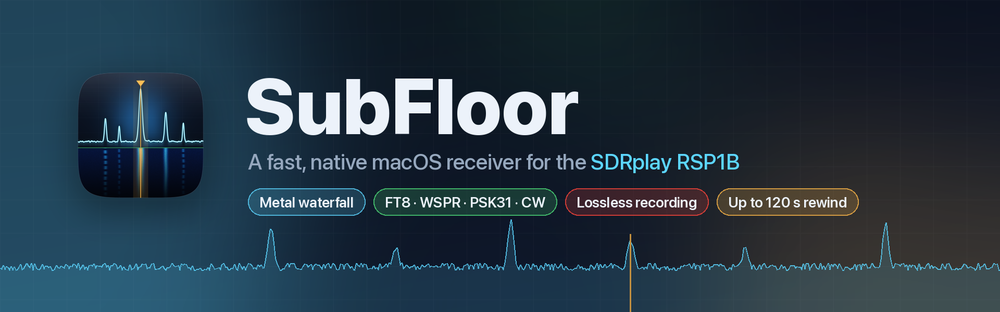
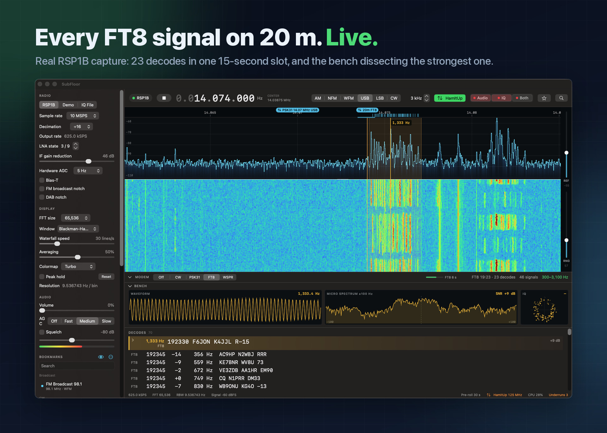
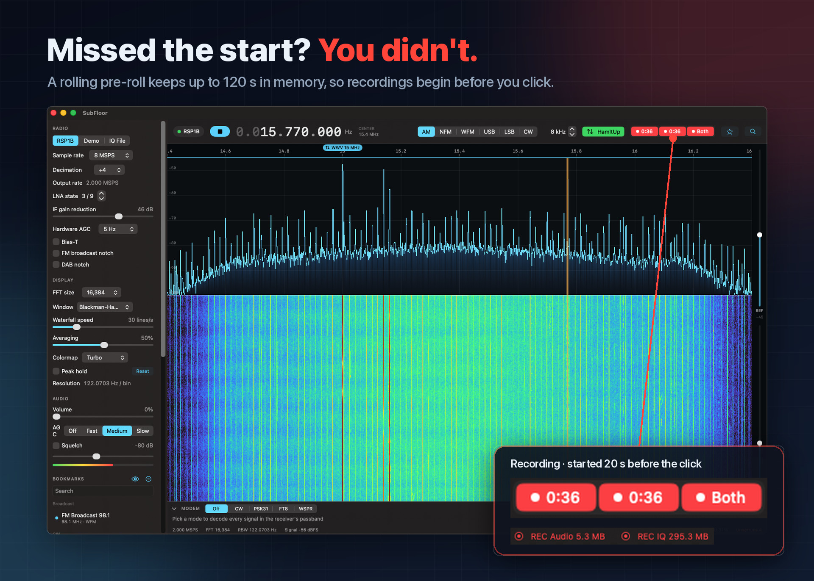
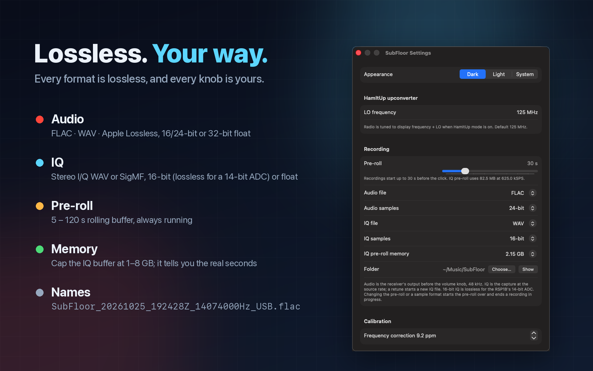
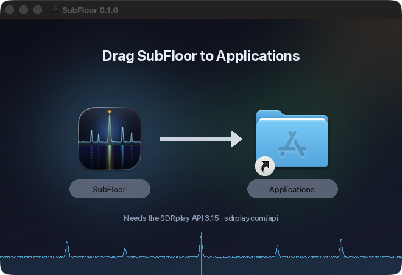
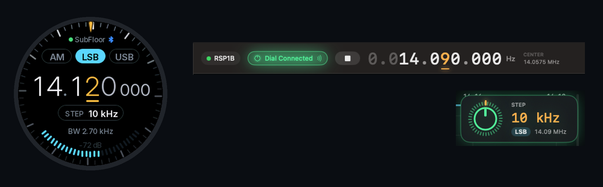

<p align="center">
  
</p>

<p align="center">
  <a href="https://github.com/RidgebackZulu/SubFloor/releases/latest"></a>
</p>

<p align="center">
  
  
  
  
</p>

<h3 align="center">Plug in your RSP1B, hit Space, and watch the band light up.</h3>

SubFloor is a native macOS receiver for the SDRplay RSP1B. It's built for Apple Silicon, with a Metal
waterfall that keeps up with the radio. It decodes every digital signal in your passband at once, and it
records lossless audio and IQ that start *before* you press the button.

## ✨ What it does

- 🌊 **A waterfall that keeps up.** Metal rendering at up to 120 fps, FFTs up to 65,536 points, and
  pinch, zoom and pan that never retune the radio.
- 📡 **Decodes the whole passband at once.** Every CW, PSK31, FT8 and WSPR signal in the receiver's
  passband gets its own decoder. Click one and the bench shows its waveform, its spectrum within
  ±100 Hz and its IQ.
- ⏪ **Records the past.** A rolling pre-roll keeps the last 5 to 120 seconds in memory, so a recording
  starts before your click. FLAC, WAV, Apple Lossless or SigMF, and all of it lossless.
- 🔴 **Records while you're away.** Auto records every transmission the squelch lets through, and the
  Recordings window lays the day out in lanes, one per frequency, with a player you can scrub from the
  Dial. [More below](#auto-record).
- 🎧 **Every voice mode.** AM, NFM, WFM, USB, LSB and CW, with AGC, squelch and drag-to-resize
  passbands.
- ⬆️ **HamItUp in one click.** Upconverter mode tunes the radio 125 MHz above what you see, so HF and
  LF work through a HamItUp.
- 🎛️ **A real tuning knob.** The SubFloor Dial (an M5Stack Dial) tunes from 1 Hz to 1 MHz a step,
  switches AM/LSB/USB with a tap, and connects over Bluetooth or USB. [More below](#subfloor-dial).
- 🔖 **Bookmarks on the spectrum.** Flags float above the signals; click one to tune, right-click to edit.
- 🛟 **Calm when the radio isn't.** No RSP or a stuck SDRplay service? SubFloor falls back to a built-in
  demo signal and tells you how to fix it.

## 📡 Every FT8 signal on 20 m, live

<p align="center"></p>

That's a real capture from an RSP1B through a HamItUp: 23 FT8 messages decoded in one 15-second slot,
from across North America and Europe. The amber row is locked on the strongest signal, and the bench
above the list takes it apart.

## ⏪ Missed the start? You didn't.

<p align="center"></p>

The 19 m shortwave broadcast band, two megahertz wide. Both recordings started 20 seconds before the
click, because the save buffer never stops running. Press **Audio**, **IQ** or **Both** (⌘⇧A, ⌘⇧I,
⌘⇧R) and SubFloor writes what it has already heard, then keeps going.

## 🎛 Lossless, your way

<p align="center"></p>

## 🚀 Install

<p align="center"></p>

1. **Install the [SDRplay API 3.15](https://www.sdrplay.com/api/).** SubFloor links against it and
   won't open without it.
2. **Download `SubFloor-x.y.z.dmg`** from the [latest release](https://github.com/RidgebackZulu/SubFloor/releases/latest),
   open it, and drag SubFloor to Applications.
3. **Open it.** SubFloor is signed with a Developer ID and notarized by Apple, so it opens like any
   other app.

You need an Apple Silicon Mac with macOS 15 or later. No radio yet? SubFloor runs a built-in demo
signal around 14.1 MHz, so you can explore everything first.

## Build from source
You need macOS 15 or later on Apple Silicon, Xcode 26 (Swift 6.2), and the
[SDRplay API 3.15](https://www.sdrplay.com/api/) installed at `/usr/local/lib/libsdrplay_api.dylib`.
```bash
swift run -c release SubFloor        # run from source
scripts/bundle.sh                    # build build/SubFloor.app (with its icon)
VERSION=0.1.0 SIGN_IDENTITY="Developer ID Application: …" scripts/make_dmg.sh   # signed release DMG
python3 scripts/make_icon.py Sources/SubFloor/Resources/AppIcon.png   # redraw the icon (needs Pillow, NumPy)
swift test                           # unit tests
SUBFLOOR_HW=1 swift test             # also run the RSP1B hardware smoke test
```

### When the RSP won't connect
The SDRplay API service must be running, or the RSP can't be opened: SubFloor then falls back to the
demo signal (use Retry once it is up). If the service stops answering (a client that died inside the
API can leave its lock held), SubFloor shows "Connecting…", then runs the demo signal with a banner.
Restart the service with `sudo launchctl kickstart -k system/com.sdrplay.service` (the banner copies
it) and reopen SubFloor. Ctrl-C, `kill` and closing the terminal quit SubFloor normally, so the RSP is
always released.

## Using it
| Action | How |
| --- | --- |
| Tune | Click the spectrum · scroll a readout digit · click readout and type `14.074`, `7074k`, `144.39m` |
| Quick tune | ⌘L or `/` — frequency or bookmark name (`ft8 20`) |
| Run / Stop | Space or ⌘R |
| Open IQ recording | ⌘O (stereo I/Q WAV) |
| Record | Top-bar `Audio` / `IQ` / `Both` (⌘⇧A / ⌘⇧I / ⌘⇧R); red with the elapsed time while recording. See Recording |
| Auto-record | Top-bar `Auto` (⌘⇧T): records whenever the squelch opens. See Auto-record |
| Recordings | Top-bar `Recordings` (⌘⇧L), with a red badge counting unheard recordings |
| Noise reduction | Top-bar NR (⌘⇧N); its pop-up sets Light to Strong. Also in the Recordings player |
| Reset zoom | ⌘0 |
| Step VFO | ← / → (⇧ ×10); with a modem mode on they move the modem cursor instead |
| Mode | Top bar, or `[` / `]` |
| Zoom / pan | Pinch or ⌥-scroll / two-finger scroll or drag — never retunes the radio |
| Bandwidth | Drag the passband edges |
| Bookmarks | ⌘D add · ⌘B show on spectrum · sidebar list |
| HamItUp | Top-bar button (green when on) or ⌘U (LO set in Settings, default 125 MHz) |
| Tune a bookmark | Click its flag above the spectrum: frequency, mode, passband width and HamItUp, at the current zoom |
| Edit a bookmark | Right-click (or ⌃-click) its flag: name, frequency, mode, bandwidth, group, HamItUp; Use Current Tuning, Tune or Delete |

## Recording
The save buffer is always running: each stream keeps its last 5–120 s (Settings, default 30 s) in
memory while the radio runs, and a recording starts that far *before* the click, so a signal that has
already begun is not lost. Idle, the buttons' faint red fill shows how much pre-roll is primed.

- **Audio** is the receiver's output after AGC and squelch and before the volume knob, 48 kHz mono:
  FLAC 24-bit by default, or WAV (16/24-bit, 32-bit float) or Apple Lossless. While Auto is on it is
  taken before the squelch instead, so pauses are kept as heard on air (see Auto-record).
- **IQ** is the capture at the source rate as stereo I/Q: WAV 16-bit by default (lossless for the
  RSP1B's 14-bit ADC; the name is SDR#-style, so ⌘O reads it back), 32-bit float, or SigMF
  (`.sigmf-data` + `.sigmf-meta` with rate, centre and UTC time). A retune starts a new IQ file; WAV
  files roll just under 4 GiB.
- Files go to `~/Music/SubFloor` (Settings: folder, formats, pre-roll, and the memory the IQ pre-roll
  may use, 2 GB by default; at high rates that limit shortens the IQ pre-roll and Settings says by how much).
- Names: `SubFloor_20261022_143000Z_14074000Hz_USB.flac`, `SubFloor_20261022_143000Z_14100000Hz_IQ.wav`;
  the time is the first sample's. Stopping the radio finalises any open recording.

## Auto-record
Turn the squelch on, set it just above the noise, and press **Auto** (⌘⇧T). SubFloor then records every
transmission on its own, so you can leave it on a quiet frequency all day and come back to what it
caught. The button shows a faint red ring while it listens and turns solid red with the elapsed time
while it records.

- **Starts** once the squelch has been open for *Auto-record starts after* (Settings, default 2 s, so a lone noise
  pop doesn't make a file), and the file begins half a second before the signal did.
- **Keeps the gaps.** Inside a recording, pauses up to *Keep gaps up to* (default 8 s) are recorded as
  heard on air, squelch open, so the next words aren't clipped. Longer pauses keep 2 s after the last
  word and half a second before the next, and are silent between.
- **Stops** once the squelch has stayed shut for *and stops after* (default 30 s), and the file ends 2 s after the signal.
- Pressing **Audio** during an auto recording takes it over as a manual one. Auto never records the
  demo source, and while it is on it keeps the Mac awake (the display may sleep).

### Recordings window
**Recordings** (⌘⇧L) shows one UTC day at a time: a lane per frequency, a glowing marker per recording
(brighter with a dot until you've played it), and a faint row of the squelch pops Auto ignored. Pick a
marker to load it into the player underneath: a waveform, the playhead's UTC time to the tenth of a
second, and jump chips from 0.1 s to 5 min.

| In the Recordings window | Does |
| --- | --- |
| Click or drag the waveform | Move the playhead |
| Space | Play / pause |
| Skip silence | Jump silent stretches while playing (on by default) |
| ← / → | Jump back / forward by the chosen jump |
| ⇧← / ⇧→ | Previous / next recording that day |
| Clear | Mark every recording heard |

Noise reduction acts only on what you hear, never on what is recorded or decoded.

The live radio is silent while the window is open and comes back when you close it.

## SubFloor Dial
<p align="center"></p>

An [M5Stack Dial](https://docs.m5stack.com/en/core/M5Dial) becomes a tuning knob for SubFloor, over
Bluetooth LE or USB (USB wins when both are up). The top-bar chip glows "Dial Connected", the readout
underlines the digit the knob tunes, and a HUD shows the knob, step and mode while you turn it.

| On the dial | Does |
| --- | --- |
| Turn | Tune by the step (the amber digit) |
| Press | Next coarser step, 1 Hz → 1 MHz, then back to 1 Hz |
| Hold and turn | Pick the step |
| Long-press | Settings: Bluetooth, acceleration, direction, brightness, sounds |
| Tap AM / LSB / USB | Switch mode |
| Tap a digit · swipe | Tune that digit · coarser / finer step |
| Tap ◀ / ▶ on the step chip | Finer / coarser step (narrower / wider in bandwidth mode) |
| Tap the BW line | The knob sets the bandwidth; press to go back to tuning |

**Scrubbing recordings** (firmware 1.1.0 or later): while the Recordings window is in front with a
recording picked, the Dial turns pink and scrubs it. Turn to jump the playhead, tap the screen to play
or pause, and tap ◀ / ▶ on the jump chip (or press, swipe, or hold and turn) to change the jump. The
screen shows the playhead's UTC time and a progress ring. It goes back to tuning when the window
closes or loses focus.

**Firmware:** a new Dial takes the full image from the release:
`esptool.py --chip esp32s3 write_flash 0 SubFloorDial-1.1.0.bin`. To update a Dial that already runs
SubFloor firmware and keep its settings and Bluetooth pairing, write just the app:
`esptool.py --chip esp32s3 write_flash 0x10000 SubFloorDial-1.1.0-app.bin`.
**Pairing:** on the dial, long-press › Bluetooth › Pair new Mac; in SubFloor, click the Dial chip ›
Pair New Dial (or Settings › SubFloor Dial). Over USB, just plug it in. Code: `Sources/SubFloor/Dial/`.

## Modem panel
Pick a mode (CW, PSK31, FT8, WSPR) in the panel under the spectrum. The modem decodes what the receiver
is tuned to: its window is the receiver's passband (on USB, 300 Hz up to the passband's top edge, at
most 3300 Hz above the dial, which is the VFO), so you hear what is decoded, and the receiver's audio
keeps playing. Tune with the VFO as usual and widen or narrow the passband by dragging its edges; the
panel shows the band being decoded. Changing mode starts afresh: nothing of the old mode carries over.

| Action | How |
| --- | --- |
| Analyse a signal | Click it inside the passband: the amber cursor snaps to the nearest tracked signal and follows it; the bench shows its waveform, ±100 Hz spectrum and IQ. Clicking outside the passband still tunes the VFO |
| Analyse a decode | Click a row in the decode list (FT8/WSPR messages included): the cursor goes to that signal and the bench shows it; the row turns amber |
| Unlock the cursor | Esc, click the cursor again, or click its (amber) row |
| Next / previous signal | ← / → while a mode is on (instead of stepping the VFO) |
| Signal history | A CW/PSK31 row's chevron shows its full history |
| Pause new rows | Hover the list; "N new ↓" shows them |

The decode list is always shown: the cursor's row first, then FT8/WSPR messages (newest slot first),
then the other CW/PSK31 signals. FT8 and WSPR need a live radio (RSP1B or Demo): they are off for IQ
files. Slot timing is UTC from the system clock, and the panel warns when the clock is more than 1 s
off. After each slot the strip shows its outcome: "WSPR 14:32 · 2 decodes", "· no decodes", or
"· skipped (audio gap)" when some of the slot's audio was lost. FT8 and WSPR search the whole decode
band, so a HamItUp oscillator a few hundred hertz off (2 ppm at 125 MHz is 250 Hz) still decodes; the
decoded audio frequencies then show the error, which Settings' HamItUp LO corrects. If the passband can't be decoded (narrower than 50 Hz above 300 Hz), the panel says so.

RTTY and auto-detect are disabled for now; their code is kept (`RTTYModem`, `SignalClassifier`, and the
engine's support for both) and covered by the tests.

## Manual hardware checklist
Run through this with an RSP1B attached before a release:
- [ ] Tune: click, type a frequency, scroll a digit, pick a bookmark
- [ ] Gain: change LNA state and IF gain reduction; level responds
- [ ] Overload banner: strong signal shows the banner, "Reduce gain" clears it
- [ ] Unplug the RSP, see the banner, replug, press Retry
- [ ] Change the sample rate while running
- [ ] Quit, then relaunch: no "device busy" error
- [ ] Switch the audio output device while running; audio continues

## Adding a modem
Modems decode the box's 12 kHz real USB audio on the modem thread (`ModemEngine`).
1. Add a case to `ModeID` (`Sources/Modems/Framework/ModemTypes.swift`) with its label, listen filter
   width and lock range (the compiler points to the other switches over modes).
2. Create `Sources/Modems/<Name>/` with either
   - a `StreamingModem` (continuous modes, one decoder per tracked signal): `id` and
     `makeDecoder(frequencyHz:sampleRate:)` returning a `SignalDecoder` (`process(_:)` returns new
     text; `frequencyHz` follows the signal; `submode`; `constellation()` for the bench; `reset()`), or
   - a `SlotModem` (fixed UTC slots): `id`, `slotSeconds` and
     `decode(samples:sampleRate:slotStart:audioBand:)` returning `[SlotDecode]`, run off the modem
     thread on each complete slot.
3. Add one line: the type to `ModemCatalog.streaming` or `ModemCatalog.slot` in the same file, and
   the mode to `ModemControl.offeredModes` (`Sources/SubFloor/App/ModemControl.swift`) for the panel.
4. Add tests in `Tests/ModemsTests` (see `Tests/ModemsTests/Support/ModemTestSignals.swift`).
